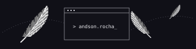

<h1 align="center">Olá 👋, sou Andson Rocha</h1>

<strong>Graduando em Tecnologia da Informação · UFERSA</strong>

<code>Full Stack · UX · Cloud</code>

Gosto de entender o caminho entre um clique na interface e os dados que chegam à tela.

<h2 align="center">🪶 Sobre mim</h2>

Estudo no Bacharelado Interdisciplinar em Tecnologia da Informação da UFERSA, no campus Pau dos Ferros, no Rio Grande do Norte.

No desenvolvimento Full Stack, gosto de acompanhar os dois lados de uma aplicação. Trabalho com interfaces em React e TypeScript e exploro como APIs e bancos de dados sustentam essas interações.

A acessibilidade influencia a forma como penso uma interface, desde a navegação pelo teclado até o texto que um leitor de tela anuncia. Também me interesso por infraestrutura em nuvem.

 

<h2 align="center">🤝 Conecte-se comigo</h2>

<a href="https://andsonrocha.vercel.app/">Portfólio ↗</a> · <a href="https://github.com/Andsonyz">GitHub ↗</a>

<h2 align="center">💻 Tecnologias</h2>

<h2 align="center">📊 Estatísticas do GitHub</h2>

<h2 align="center">📈 Gráfico de atividade</h2>

<a href="https://github.com/Andsonyz?tab=overview">Ver histórico de contribuições no GitHub ↗</a>

